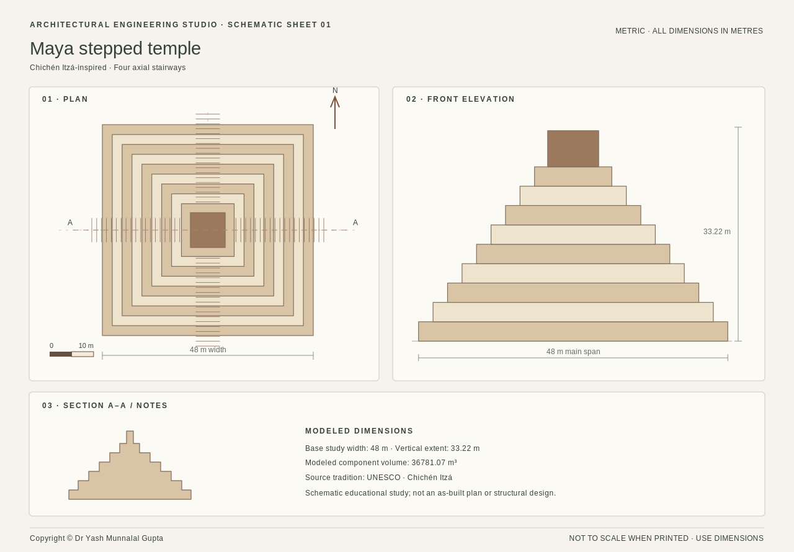

# Ancient Architecture Engineering Studio

**An interactive, browser-based studio for exploring ancient and historic architectural forms — in one HTML file.**

Experiment with geometry and proportions, compare architectural traditions, build custom block assemblies, and export study drawings. The app is designed for education, architectural visualization, and creative exploration, **not** for structural engineering or archaeologically exact reconstruction.



## Try the studio

1. Open **[`index.html`](index.html)** in a modern WebGL2-compatible browser (Chrome, Edge, or Firefox).
2. Select an architectural form, adjust its dimensions, and orbit the 3D model.
3. To edit individual pieces, select **Custom** → **Add component** → **Select & move**. Click a component in the scene and drag it, or enter exact numbers in the builder panel.
4. Use **Export study** to download your work. The app also has **Save / My studies** for browser-local study storage, when storage is available.

No build step, npm install, server, or account is needed to **run** the app. The 3D renderer is bundled into the HTML. Internet access is only needed for the optional Google Fonts import and for following external reference links; fonts have local fallbacks.

> **WebGL requirement:** 3D display needs browser WebGL2 and compatible graphics drivers. When unavailable, the app can still present non-3D content and some study exports. For reliable editing, test in an up-to-date desktop browser with graphics acceleration enabled.

## Architectural forms

- Egyptian pyramid; stepped pyramid (including a Mesopotamian ziggurat variant)
- Classical temple; Nagara, Dravida, and Hoysala-inspired temples
- Maya-inspired stepped temple; Khmer-inspired five-tower sanctuary
- Sanchi-inspired Buddhist stupa; Chinese timber pagoda
- Roman aqueduct; custom component assemblies

These are **interpretive form studies** with simplified geometry. Historical labels and educational notes should not be read as claims of measured reconstruction or structural stability. See [historical framing](docs/HISTORICAL-FRAMING.md).

## Main features

- Parametric dimensions, masonry-style materials, architectural elements, optional planning grids
- Mouse picking and dragging of custom components, axis-constrained movement, snapping, selection highlighting, and camera-orbit mode
- Builder actions including add, duplicate, delete, place-above, numeric edits, undo/redo, and keyboard shortcuts
- Plan-view and 3D-view controls; dimensions, cutaways, grid, and screenshots where supported
- SVG plan/elevation drawing export, PNG image export, JSON study export, and portable single-file HTML study export
- Day/dusk/night atmosphere and illustrated or user-uploaded background images
- Browser-local saved studies (capacity and persistence depend on browser storage)

**Important:** User-uploaded background pictures are session-only; they are **not embedded** into saved studies or HTML/JSON exports. Masonry volume and block-count figures are modeling estimates, not engineering or bill-of-materials calculations. The timber pagoda should not be taken as a stone quantity estimate.

## Publish with GitHub Pages

1. Create a **public GitHub repository** (for example `ancient-architecture-studio`).
2. Unzip this package and upload **all files and folders to the repository root**. Do **not** upload only the ZIP, because GitHub does not automatically unpack it into a website.
3. Open **Settings → Pages**, then select **Deploy from a branch**, branch **main**, folder **/(root)**, and save.
4. Once deployed, use the GitHub Pages URL shown under Pages. No website build workflow is required because `index.html` is already the app.

See [GitHub Pages documentation](https://docs.github.com/en/pages/quickstart). If your GitHub repository has a different default branch or uses organization policies, adapt the steps accordingly.

## Contribute

Contributions are welcome! Good starting points include bug reports, improving accessibility, faster geometry updates, measured references, smarter snapping, precision-editing tools, tests, and documentation. Review [CONTRIBUTING.md](CONTRIBUTING.md) and [ROADMAP.md](ROADMAP.md) before opening a pull request. Use the issue templates for reproducible bugs and feature proposals.

For development checks, install Node.js (v20+ recommended) and run:

```bash
npm test
```

There are **zero npm dependencies**. This command checks the HTML's embedded JavaScript syntax and important integration points; manual browser testing is still necessary (see [TESTING](docs/TESTING.md)).

## Repository map

| Path | Purpose |
|---|---|
| `index.html` | Entire app; this is the file served by GitHub Pages and downloadable for offline use |
| `examples/` | Exported sample plan (SVG and PNG) |
| `docs/` | Usage help, architecture overview, research limitations, tests, roadmap and blog draft |
| `.github/` | Issue templates, pull-request template and GitHub Actions validation |
| `scripts/validate.mjs` | Simple self-contained static checks |
| `CONTRIBUTING.md`, `CODE_OF_CONDUCT.md`, `SECURITY.md` | Community project policies |
| `LICENSE`, `THIRD_PARTY_NOTICES.md` | Proposed open-source license and dependency attribution |

## License, acknowledgements, and attribution

The **project's proposed license is MIT**; before publishing, the repository owner should confirm this is the license they intend to grant. See [LICENSE](LICENSE). The HTML includes bundled **Three.js** code with its original MIT license header. See [THIRD_PARTY_NOTICES.md](THIRD_PARTY_NOTICES.md) for third-party credits. The editor's interaction design draws conceptual inspiration from [CADCraft](https://github.com/storytold/cadcraft); it is **not a fork or redistribution of CADCraft**.

**Copyright credit: Dr Yash Munnalal Gupta.** Please retain this credit and any applicable third-party notices when redistributing modified versions, consistent with their licenses.

If you reference this project in educational or research writing, see [`CITATION.cff`](CITATION.cff). Read [the planned development roadmap](ROADMAP.md) and [the editable announcement](docs/BLOG_POST_DRAFT.md).
